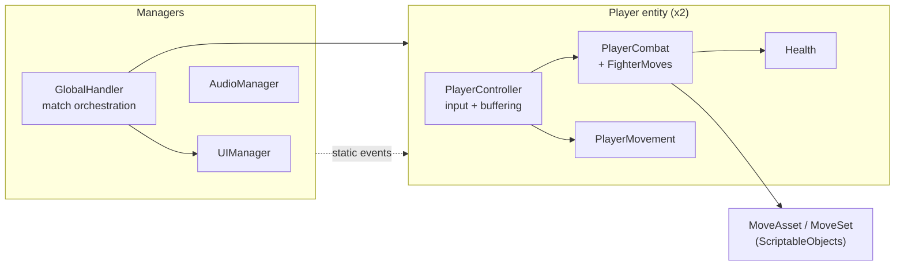
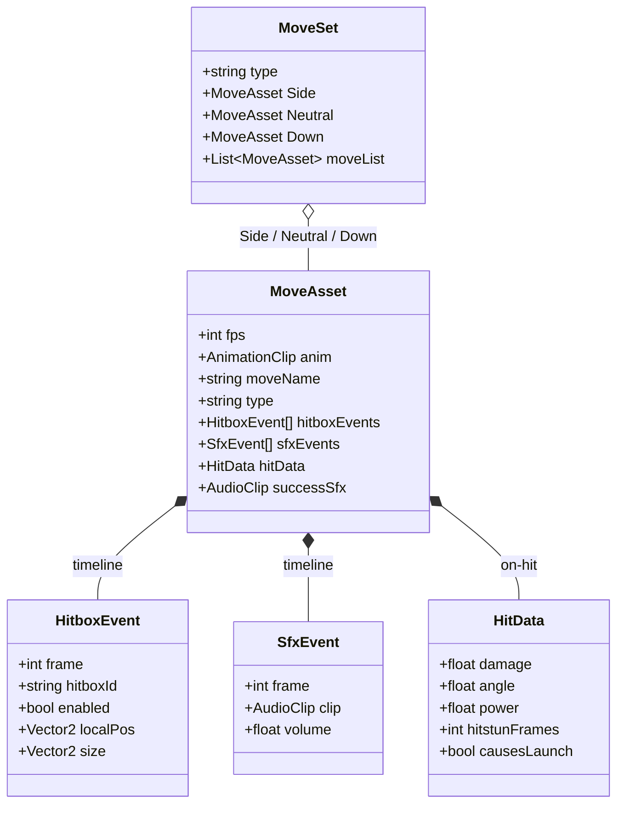
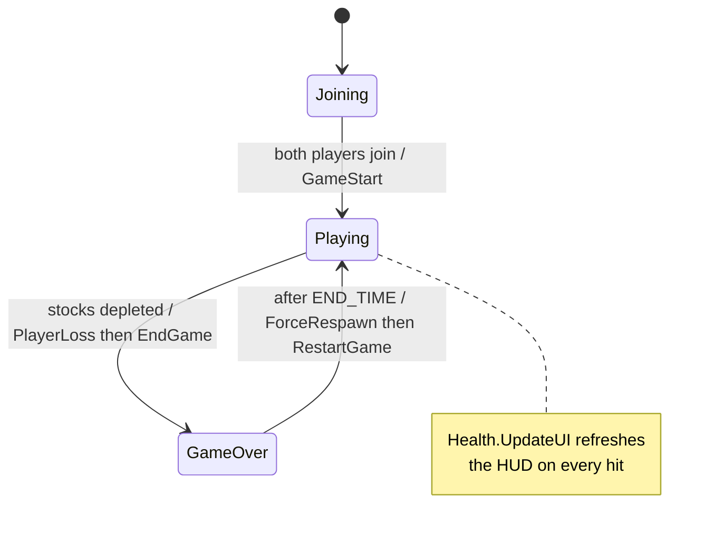

# Reflect
A 2D platform fighter built in Unity and C#: Smash-style percentage damage, knockback that scales with damage, and ring-out stocks. Local two-player on one device, with a fully data-driven, frame-based combat system.

**[View/Download the game on itch.io!](https://aarongt0.itch.io/reflect)**

[Full Match Demo](https://www.youtube.com/watch?v=4BsfhBoHJt4)

- NOTE: Development history was lost when moving the project between repos; this is a clean upload of the final version.
---
## Features

- **Frame-data combat** — every move is a timeline of hitbox and SFX events fired on exact frames, advanced by a fixed-timestep accumulator so timing is independent of frame rate.
- **Data-driven moves** — attacks are authored as `ScriptableObject` assets (`MoveAsset` / `MoveSet`), not hard-coded, so new moves are built in the Inspector.
- **Input buffering** — presses are queued in a short rolling window and resolved by context (a light attack becomes a directional or aerial variant based on movement and grounded state).
- **Percentage + knockback scaling** — damage raises a percentage that scales launch force, with hitstun, launch/stun states, and ring-out respawns over a stock count.
- **Parry system** — a timed parry that, on success, launches the attacker instead of the defender.
- **Audio** — pitch-jittered SFX and a looped soundtrack.
- **UI Toolkit HUD** — live percentages, stock indicators, and a match-state-driven join / play / game-over flow.

## Built with
 
- **Unity** (2D, `Rigidbody2D` physics)
- **C#**
- **Unity Input System** — `PlayerInput` with a `Fight` action map
- **UI Toolkit** — `UIDocument`-based HUD

---

## Architecture
The codebase is organized into three layers:
1. Persistent managers that handle state, audio, and UI
2. Component-composed player entity (instantiated twice)
3. ScriptableObject data layer

**Moves are data, not code.** Each attack is a `MoveAsset` carrying its own frame timeline of hitbox and SFX events plus on-hit data, grouped into `MoveSet`s — new moves are authored in the Inspector, not compiled. `GameAction` is a lightweight cooldown schema the `PlayerController` reads when assigning per-action cooldowns (dash, parry, etc.), keeping that timing data-driven too.

**Match flow is event-driven.** `GlobalHandler` orchestrates the match lifecycle and `UIManager` mirrors it, entirely through static C# events. A loss triggers a timed sequence that resets stocks and loops back into a fresh round.

---

## Controls
 
Two players join on one device — press any button to join (supports Mouse/Keyboard and Gamepad). Actions in the `Fight` map: move, jump, dash, sink (fast-fall), light attack (neutral / side / down, on ground or in air), and parry.
 
## Status
 
Playable prototype — core combat, movement, and match loop are in. Balance and a full QA pass are ongoing; the focus so far has been on the systems architecture rather than tuning.
